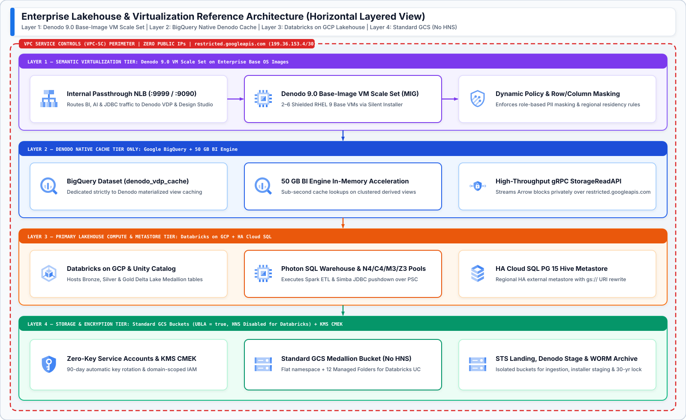
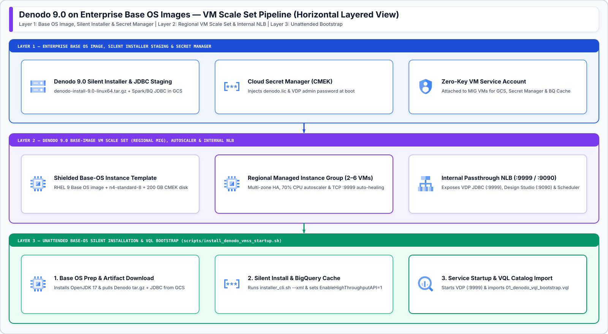
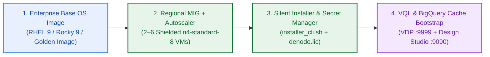
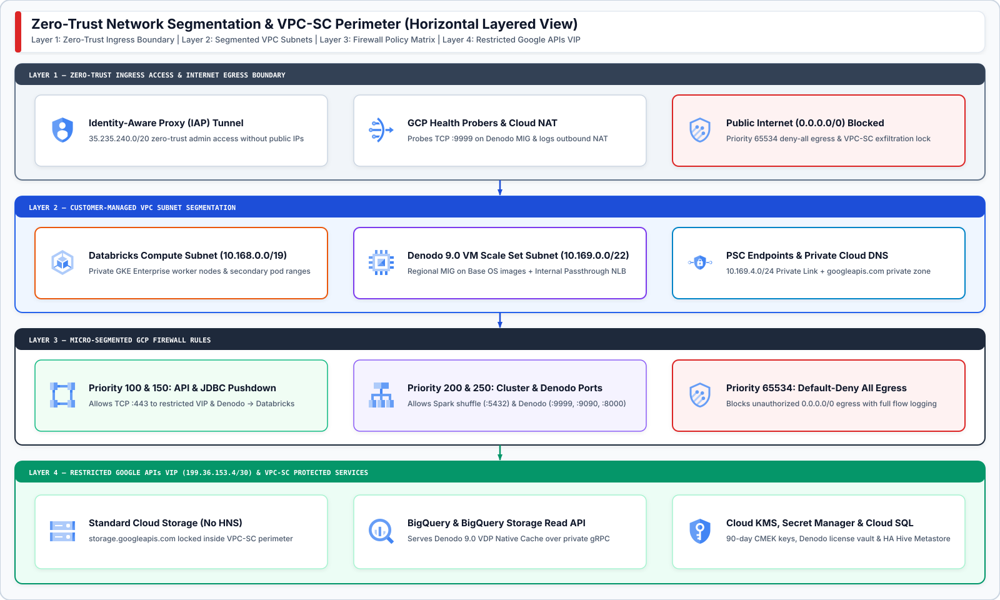
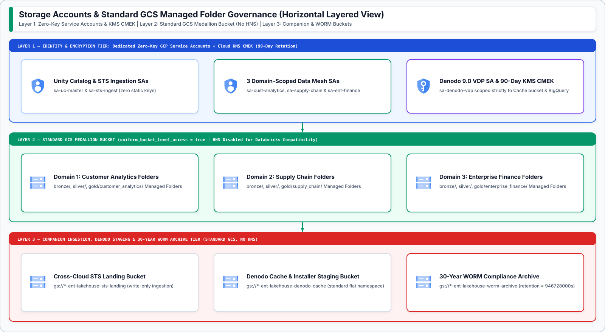

# Enterprise Lakehouse & Virtualization on Google Cloud

> **Databricks on GCP** + **Denodo 9.0 VM Scale Set on Enterprise Base OS Images (Regional MIG + Autoscaler)** + **BigQuery Native VDP Cache (BI Engine)** + **Standard GCS Managed Folders (HNS Disabled for Databricks Compatibility)** + **VPC Service Controls**

[](./terraform)
[](https://cloud.google.com)
[](https://www.databricks.com/product/google-cloud)
[](./terraform/modules/denodo_vdp_platform)

---

## 1. End-to-End Horizontal Architecture

<p align="center">
  
</p>

| Horizontal Layer | Core Platform | Role in Architecture |
| :--- | :--- | :--- |
| **Layer 1 — Consumers** | Vertex AI, BI Tools, JDBC/ODBC | Queries Denodo Internal NLB (`10.169.0.50`) |
| **Layer 2 — Virtualization** | **Denodo 9.0 VM Scale Set on Base OS Images (`2–6` VMs)** | Semantic VDP `:9999`, Design Studio `:9090`, Scheduler `:8000` |
| **Layer 3 — VDP Cache** | **BigQuery (`denodo_vdp_cache`) + BI Engine** | Sub-second Denodo cache (`50 GB` RAM) |
| **Layer 4 — Lakehouse** | **Databricks on GCP (Unity Catalog)** | Delta Lake ETL (`Bronze → Silver → Gold`) |
| **Layer 5 — Storage** | **4 Standard GCS Buckets (No HNS) + Cloud KMS CMEK** | UBLA + Managed Folders, 90-day KMS rotation & 30-yr WORM |

---

## 2. Denodo 9.0 VM Scale Set on Enterprise Base OS Images

Instead of relying on pre-packaged Marketplace appliances, the virtualization tier boots from **hardened Enterprise Linux Base OS Images** (`projects/rhel-cloud/global/images/family/rhel-9` or custom CIS-hardened golden base images) and installs **Denodo Platform 9.0** (`Virtual DataPort`, `Design Studio`, and `Denodo Scheduler`) via an unattended silent installer staged in Google Cloud Storage and licensed via Cloud Secret Manager.

<p align="center">
  
</p>



| VM Scale Set Resource | Terraform Type | Denodo 9.0 Base-Image Specification |
| :--- | :--- | :--- |
| **Enterprise Base OS Image** | `var.denodo_source_image` | `projects/rhel-cloud/global/images/family/rhel-9` (or custom CIS-hardened base image) |
| **Shielded Instance Template** | `google_compute_instance_template` | `n4-standard-8`, `200 GB` CMEK Hyperdisk, Secure Boot + vTPM |
| **Regional VM Scale Set (MIG)** | `google_compute_region_instance_group_manager` | Multi-zone (`europe-west2-a/b/c`), `PROACTIVE` zero-downtime replacement |
| **Regional CPU Autoscaler** | `google_compute_region_autoscaler` | `min_replicas = 2`, `max_replicas = 6`, target CPU `70%` |
| **Auto-Healing Health Check** | `google_compute_region_health_check` | TCP `:9999` (VDP Server) every `15s`, `300s` startup delay |
| **Internal Passthrough NLB** | `google_compute_forwarding_rule` | Static VIP across ports `9999, 9996, 9090, 9443, 8000` |
| **Design Studio & Scheduler** | Web Tools on `:9090` / `:9443` | `/denodo-design-studio/` & `/webadmin/denodo-scheduler-admin/` |

---

## 3. Zero-Trust Network & VPC-SC Perimeter

<p align="center">
  
</p>

| Subnet / Control | CIDR / Priority | Purpose |
| :--- | :--- | :--- |
| `snet-databricks-workers` | `10.168.0.0/19` | Customer-managed Databricks Private GKE compute plane |
| `snet-denodo-vdp` | `10.169.0.0/22` | Denodo 9.0 Base-Image VM Scale Set (`2–6` VMs) + Internal NLB |
| `snet-psc-endpoints` | `10.169.4.0/24` | Private Google APIs (`199.36.153.4/30`) & Databricks SCC relay |
| **VPC-SC Perimeter** | `vpcsc_perimeter` | Isolates `storage`, `bigquery`, `compute`, `cloudkms`, `secretmanager` |

---

## 4. Storage Accounts & Standard GCS Managed Folder Governance (No HNS)

> **Databricks Compatibility Note**: **Hierarchical Namespace (HNS) is disabled** across all GCS buckets because Databricks on GCP / Unity Catalog does not support HNS-enabled buckets. Subfolder IAM isolation is enforced on standard flat-namespace GCS buckets (`uniform_bucket_level_access = true`) using **GCS Managed Folders (`google_storage_managed_folder`)** and **Unity Catalog External Locations**.

<p align="center">
  
</p>

| Identity / Bucket | Managed Folder Scope (Standard GCS, No HNS) | Access Level |
| :--- | :--- | :--- |
| `sa-cust-analytics` | `*-ent-lakehouse/{bronze,silver,gold}/customer_analytics/` | Folder-Scoped (`storage.objectAdmin`) |
| `sa-supply-chain` | `*-ent-lakehouse/{bronze,silver,gold}/supply_chain/` | Folder-Scoped (`storage.objectAdmin`) |
| `sa-ent-finance` | `*-ent-lakehouse/{bronze,silver,gold}/enterprise_finance/` | Folder-Scoped (`storage.objectAdmin`) |
| `sa-dbx-uc` | `*-ent-lakehouse/{bronze,silver,gold}/` | Unity Catalog External Location (`objectAdmin`) |
| `sa-denodo-vdp` | `*-denodo-cache/` & `BigQuery denodo_vdp_cache` | Bulk Load Staging + BigQuery `readSessionUser` |

---

## 5. Quickstart Deployment (4 Commands)

```bash
# 1. Configure environment variables (uses RHEL 9 Base OS image & standard GCS buckets)
cp terraform/terraform.tfvars.example terraform/terraform.tfvars

# 2. Provision VPC, KMS CMEK, 4 Standard GCS Buckets (No HNS), BigQuery Cache, Databricks & Denodo 9.0 VM Scale Set
cd terraform && terraform init && terraform apply

# 3. Stage Denodo 9.0 silent installer + JDBC drivers + VQL & trigger zero-downtime VM Scale Set rollout
cd .. && ./scripts/deploy_denodo_vm_scaleset.sh \
  --project-id "<YOUR_GCP_PROJECT_ID>"

# 4. Run offline Terraform & architecture verification suite (20/20 checks)
python3 tests/validate_all.py
```

---

## 6. Repository Structure

```text
├── assets/                               # 4 Horizontal-Layered SVG/PNG Architecture Blueprints
├── docs/                                 # Visual Architecture & Denodo 9.0 Base-Image Reference Guide
├── scripts/
│   ├── deploy_denodo_vm_scaleset.sh      # Operator CLI: stages installer/drivers/VQL & rolls Denodo 9.0 VM Scale Set
│   ├── install_denodo_vmss_startup.sh    # Unattended GCE Base OS startup script (Silent Installer + BQ Cache)
│   └── generate_architecture_diagrams.py # Generates all 4 Horizontal SVG/PNG Blueprints
├── sql/
│   ├── 01_denodo_vql_bootstrap.vql       # Auto-imported VQL (Databricks JDBC + BigQuery Cache + Views)
│   ├── 02_hive_metastore_uri_rewrite.sql # Transactional abfss:// -> gs:// Hive Metastore migration SQL
│   └── 03_databricks_unity_catalog_medallion_ddl.sql # Unity Catalog Medallion DDL
├── terraform/
│   ├── main.tf                           # Root orchestrator across 6 modular domains
│   └── modules/
│       ├── network_and_psc/              # Custom VPC, subnets, Cloud NAT, 5 firewalls, Private DNS, VPC-SC
│       ├── gcs_medallion_lakehouse/      # 90-day KMS CMEK, 5 SAs, 4 Standard GCS buckets (No HNS), 12 Managed Folders
│       ├── external_hive_metastore/      # Regional HA Cloud SQL PostgreSQL 15 Hive Metastore
│       ├── databricks_workspace/         # Next-Gen N4/C4/M3/Z3 pools + Unity Catalog locations
│       ├── bigquery_biglake/             # denodo_vdp_cache dataset + 50 GB BI Engine reservation
│       └── denodo_vdp_platform/          # Denodo 9.0 Base-OS VM Template + Regional MIG + Autoscaler + NLB
└── tests/validate_all.py                 # 20-point automated structural & security test suite
```
