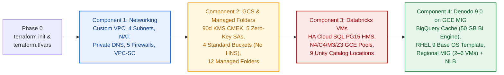
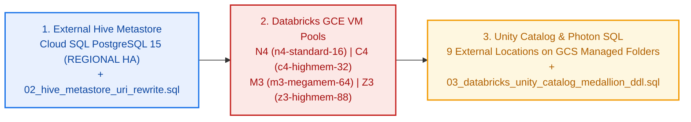
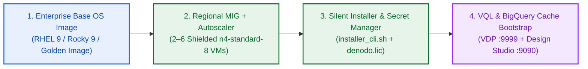

# Enterprise Lakehouse & Virtualization on Google Cloud

> **Databricks on GCP** + **Denodo 9.0 VM Scale Set on Enterprise Base OS Images (Regional MIG + Autoscaler)** + **BigQuery Native VDP Cache (BI Engine)** + **Standard GCS Managed Folders (HNS Disabled for Databricks Compatibility)** + **VPC Service Controls**

[](./terraform)
[](https://cloud.google.com)
[](https://www.databricks.com/product/google-cloud)
[](./terraform/modules/denodo_vdp_platform)
[](./docs/STEP_BY_STEP_COMPONENT_INSTALLATION_GUIDE.md)

---

## 1. End-to-End Horizontal Architecture

<p align="center">
  
</p>

| Horizontal Layer | Core Platform | Role in Architecture |
| :--- | :--- | :--- |
| **Layer 1 — Consumers** | Vertex AI, BI Tools, JDBC/ODBC | Queries Denodo Internal NLB (`10.169.0.50`) |
| **Layer 2 — Virtualization** | **Denodo 9.0 on GCE Managed Instance Group (`2–6` VMs)** | Semantic VDP `:9999`, Design Studio `:9090`, Scheduler `:8000` |
| **Layer 3 — VDP Cache** | **BigQuery (`denodo_vdp_cache`) + BI Engine** | Sub-second Denodo cache (`50 GB` RAM) |
| **Layer 4 — Lakehouse** | **Databricks on GCP (Unity Catalog)** | Delta Lake ETL (`Bronze → Silver → Gold`) |
| **Layer 5 — Storage** | **4 Standard GCS Buckets (No HNS) + Cloud KMS CMEK** | UBLA + 12 Managed Folders, 90-day KMS rotation & 30-yr WORM |

---

## 2. Step-by-Step Component-by-Component Installation

> **Full Detailed Runbook**: See [**`docs/STEP_BY_STEP_COMPONENT_INSTALLATION_GUIDE.md`**](./docs/STEP_BY_STEP_COMPONENT_INSTALLATION_GUIDE.md) or run the automated step-by-step installer [`./scripts/install_components_step_by_step.sh`](./scripts/install_components_step_by_step.sh).



### Phase 0 — Workspace Initialization

```bash
export PROJECT_ID="<YOUR_GCP_PROJECT_ID>"
export REGION="europe-west2"
cp terraform/terraform.tfvars.example terraform/terraform.tfvars
terraform -chdir=terraform init
```

---

### Component 1 — Networking (`module.network_and_psc`)

<p align="center">
  
</p>

| Network Resource | CIDR / Priority | Purpose |
| :--- | :--- | :--- |
| `snet-databricks-workers` | `10.168.0.0/19` (+ Pods `/16`, Svc `/20`) | Customer-managed Databricks Private GKE & GCE compute plane |
| `snet-denodo-vdp` | `10.169.0.0/22` | Denodo 9.0 Regional MIG (`2–6` VMs) + Internal NLB (`10.169.0.50`) |
| `snet-psc-endpoints` & `snet-ilb-proxies` | `10.169.4.0/24` & `10.169.5.0/24` | Private Google APIs (`199.36.153.4/30`), SCC relay & ILB proxy |
| **5 Zero-Trust Firewalls + VPC-SC** | Priorities `100, 150, 200, 250, 65534` | Allows Restricted APIs & JDBC (`:443/:9999/:9090/:8000`); blocks all internet egress |

```bash
# Install Component 1 (Networking, Subnets, Cloud NAT, Private DNS, PSA Peering, 5 Firewalls & VPC-SC)
terraform -chdir=terraform apply -target=module.network_and_psc

# Or via the step-by-step CLI:
./scripts/install_components_step_by_step.sh --component 1 --project-id "${PROJECT_ID}"
```

---

### Component 2 — GCS Managed Folder & Bucket Structure (`module.gcs_medallion_lakehouse`)

> **Databricks Compatibility Note**: **Hierarchical Namespace (HNS) is disabled** across all GCS buckets because Databricks on GCP / Unity Catalog does not support HNS-enabled buckets. Subfolder IAM isolation is enforced on standard flat-namespace GCS buckets (`uniform_bucket_level_access = true`) using **12 GCS Managed Folders (`google_storage_managed_folder`)**.

<p align="center">
  
</p>

| Identity / Bucket | Managed Folder Scope (Standard GCS, No HNS) | Access Level |
| :--- | :--- | :--- |
| `sa-cust-analytics` | `*-ent-lakehouse/{bronze,silver,gold}/customer_analytics/` | Folder-Scoped (`storage.objectAdmin`) |
| `sa-supply-chain` | `*-ent-lakehouse/{bronze,silver,gold}/supply_chain/` | Folder-Scoped (`storage.objectAdmin`) |
| `sa-ent-finance` | `*-ent-lakehouse/{bronze,silver,gold}/enterprise_finance/` | Folder-Scoped (`storage.objectAdmin`) |
| `sa-dbx-uc` | `*-ent-lakehouse/{bronze,silver,gold,hive_warehouse,unity_catalog}/` | Unity Catalog External Location (`objectAdmin`) |
| `sa-denodo-vdp` | `*-denodo-cache/` & `BigQuery denodo_vdp_cache` | Silent Installer + Bulk Load Staging (`objectAdmin`) |

```bash
# Install Component 2 (90-Day KMS CMEK, 5 Zero-Key SAs, 4 Standard Buckets [No HNS] & 12 Managed Folders)
terraform -chdir=terraform apply -target=module.gcs_medallion_lakehouse

# Verify Standard GCS Bucket (UBLA = true, No HNS) & List all 12 Managed Folders
gcloud storage managed-folders list "gs://ent-prod-lakehouse-ent-lakehouse" --project="${PROJECT_ID}"
```

---

### Component 3 — Databricks VMs, Unity Catalog & External Hive Metastore (`module.external_hive_metastore` + `module.databricks_workspace`)



| Databricks Component | GCE Machine Type / SKU | Scaling & Storage | Purpose |
| :--- | :--- | :--- | :--- |
| **External Hive Metastore** | Cloud SQL `POSTGRES_15` (`db-custom-8-32768`) | `REGIONAL` HA, Private IP (`/20` PSA) | Legacy Hive metadata + `abfss://` $\rightarrow$ `gs://` rewrite |
| `pool-general-etl-n4` | `n4-standard-16` (16 vCPU, 64 GB) | `2–32` VMs, Hyperdisk Balanced | Standard Bronze $\rightarrow$ Silver Delta ETL |
| `pool-photon-c4` | `c4-highmem-32` (32 vCPU, 248 GB) | `2–24` VMs, Hyperdisk Extreme | High-concurrency Photon Gold aggregations |
| `pool-memory-reconcile-m3` | `m3-megamem-64` (64 vCPU, 976 GB) | `1–12` VMs, Hyperdisk Balanced | Large in-memory state reconciliation joins |
| `pool-shuffle-heavy-z3` | `z3-highmem-88` (88 vCPU, 704 GB) | `2–16` VMs, `9 TB` Local NVMe SSD | Multi-terabyte shuffle & sort workloads |
| **Photon SQL Warehouse** | `2X-Large` (`PRO` / Serverless) | `1–8` clusters, `15m` auto-stop | Serves Denodo 9.0 Simba Spark JDBC `:443` queries |

```bash
# Install Component 3 (Regional HA Cloud SQL PG15 Hive Metastore + Databricks VM Pools + 9 UC Locations)
terraform -chdir=terraform apply \
  -target=module.external_hive_metastore \
  -target=module.databricks_workspace

# Apply Hive Metastore URI rewrite (abfss:// -> gs://) & Unity Catalog Medallion DDL
HMS_IP=$(terraform -chdir=terraform output -raw hive_metastore_private_ip)
psql "host=${HMS_IP} port=5432 dbname=hive_metastore user=hive_admin sslmode=require" -f sql/02_hive_metastore_uri_rewrite.sql
databricks sql-cli -f sql/03_databricks_unity_catalog_medallion_ddl.sql
```

---

### Component 4 — Denodo 9.0 on GCE Managed Instance Group (MIG) + BigQuery Cache (`module.bigquery_biglake` + `module.denodo_vdp_platform`)

Instead of relying on pre-packaged Marketplace appliances, the virtualization tier boots from **hardened Enterprise Linux Base OS Images** (`projects/rhel-cloud/global/images/family/rhel-9` or custom CIS-hardened golden base images) inside a **Regional GCE Managed Instance Group (`google_compute_region_instance_group_manager`)** and installs **Denodo Platform 9.0** (`Virtual DataPort`, `Design Studio`, and `Denodo Scheduler`) via an unattended silent installer staged in Google Cloud Storage and licensed via Cloud Secret Manager.

<p align="center">
  
</p>



| VM Scale Set Resource | Terraform Type | Denodo 9.0 Base-Image Specification |
| :--- | :--- | :--- |
| **Enterprise Base OS Image** | `var.denodo_source_image` | `projects/rhel-cloud/global/images/family/rhel-9` (or custom CIS-hardened base image) |
| **Shielded Instance Template** | `google_compute_instance_template` | `n4-standard-8`, `200 GB` CMEK Hyperdisk, Secure Boot + vTPM |
| **Regional VM Scale Set (MIG)** | `google_compute_region_instance_group_manager` | Multi-zone (`europe-west2-a/b/c`), `PROACTIVE` zero-downtime replacement |
| **Regional CPU Autoscaler** | `google_compute_region_autoscaler` | `min_replicas = 2`, `max_replicas = 6`, target CPU `70%` |
| **Auto-Healing Health Check** | `google_compute_region_health_check` | TCP `:9999` (VDP Server) every `15s`, `300s` startup delay |
| **Internal Passthrough NLB** | `google_compute_forwarding_rule` | Static VIP (`10.169.0.50`) across ports `9999, 9996, 9090, 9443, 8000` |
| **BigQuery Native VDP Cache** | `google_bigquery_dataset` + `bi_engine` | `denodo_vdp_cache` dataset + `50 GB` BI Engine (`EnableHighThroughputAPI=1`) |

```bash
# 1. Provision BigQuery Denodo Cache (50 GB BI Engine) & Denodo 9.0 Regional MIG + Internal NLB
terraform -chdir=terraform apply \
  -target=module.bigquery_biglake \
  -target=module.denodo_vdp_platform

# 2. Stage Denodo 9.0 silent installer + JDBC drivers + VQL & trigger zero-downtime MIG rolling replacement
./scripts/deploy_denodo_vm_scaleset.sh \
  --project-id "${PROJECT_ID}" \
  --region "${REGION}"
```

---

## 3. Automated Validation Suite

```bash
# Run the 22-point offline Terraform, Step-by-Step Installer & Security verification suite
python3 tests/validate_all.py
```

---

## 4. Repository Structure

```text
├── assets/                                              # 4 Horizontal-Layered SVG/PNG Architecture Blueprints
├── docs/
│   ├── STEP_BY_STEP_COMPONENT_INSTALLATION_GUIDE.md     # Component-by-Component (1..4) Installation Runbook
│   └── SINGLE_ENVIRONMENT_TERRAFORM_AND_ARCHITECTURE_GUIDE.md # Deep-Dive Architecture & Terraform Reference
├── scripts/
│   ├── install_components_step_by_step.sh               # Step-by-Step CLI (--component 1|2|3|4|all)
│   ├── deploy_denodo_vm_scaleset.sh                     # Stages Denodo 9.0 installer/JDBC/VQL & rolls MIG
│   ├── install_denodo_vmss_startup.sh                   # Unattended GCE Base OS startup script (installer_cli.sh)
│   └── generate_architecture_diagrams.py                # Generates all 4 Horizontal SVG/PNG Blueprints
├── sql/
│   ├── 01_denodo_vql_bootstrap.vql                      # Auto-imported VQL (Databricks JDBC + BigQuery Cache + Views)
│   ├── 02_hive_metastore_uri_rewrite.sql                # Transactional abfss:// -> gs:// Hive Metastore migration SQL
│   └── 03_databricks_unity_catalog_medallion_ddl.sql    # Unity Catalog Medallion DDL
├── terraform/
│   ├── main.tf                                          # Root orchestrator across 6 modular domains
│   └── modules/
│       ├── network_and_psc/                             # Component 1: Custom VPC, 4 subnets, NAT, DNS, 5 firewalls, VPC-SC
│       ├── gcs_medallion_lakehouse/                     # Component 2: 90d KMS CMEK, 5 SAs, 4 Standard Buckets (No HNS), 12 Managed Folders
│       ├── external_hive_metastore/                     # Component 3A: Regional HA Cloud SQL PostgreSQL 15 Hive Metastore
│       ├── databricks_workspace/                        # Component 3B: Next-Gen N4/C4/M3/Z3 pools + 9 Unity Catalog locations
│       ├── bigquery_biglake/                            # Component 4A: denodo_vdp_cache dataset + 50 GB BI Engine reservation
│       └── denodo_vdp_platform/                         # Component 4B: Denodo 9.0 Base-OS Template + Regional MIG + Autoscaler + NLB
└── tests/validate_all.py                                # 22-point automated structural & security test suite
```
