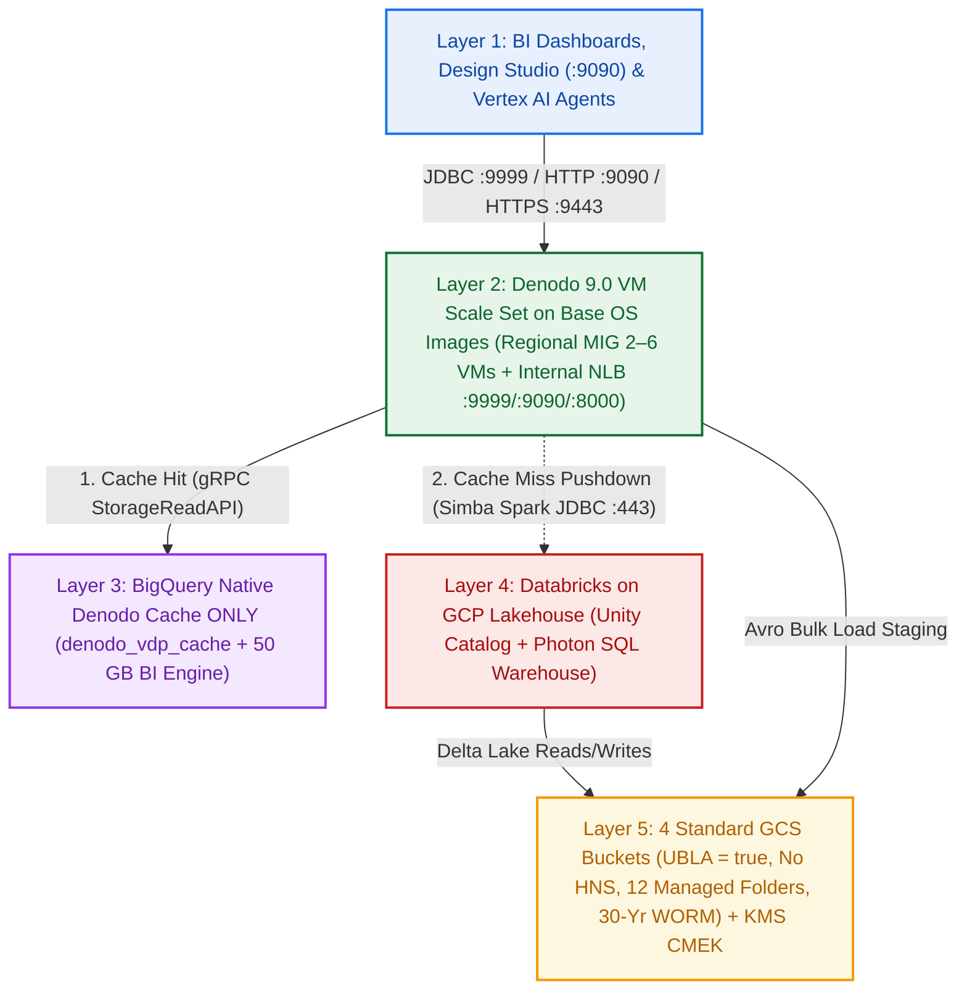

# Single-Environment Architecture & Terraform Reference Guide

> **Visual Reference Blueprint** — Databricks on GCP + **Denodo 9.0 VM Scale Set on Enterprise Base OS Images** (`google_compute_region_instance_group_manager`) + BigQuery Native VDP Cache (`denodo_vdp_cache`) + Standard GCS Managed Folders (`HNS Disabled for Databricks Compatibility`) + VPC Service Controls
>
> **Looking for the Step-by-Step Installation Runbook?** See [**`STEP_BY_STEP_COMPONENT_INSTALLATION_GUIDE.md`**](./STEP_BY_STEP_COMPONENT_INSTALLATION_GUIDE.md).

---

## 1. End-to-End Horizontal Reference Architecture

<p align="center">
  
</p>



| Architectural Principle | Implementation | Verification |
| :--- | :--- | :--- |
| **Databricks = Primary Lakehouse** | Unity Catalog + Photon SQL Warehouse + N4/C4/M3/Z3 Pools | Liquid-Clustered Delta tables |
| **Standard GCS (No HNS)** | `uniform_bucket_level_access = true` (HNS disabled as unsupported by Databricks) + 12 Managed Folders | Full Unity Catalog compatibility |
| **BigQuery = Denodo Cache ONLY** | `denodo_vdp_cache` dataset + `50 GB` BI Engine + `EnableHighThroughputAPI=1` | Sub-second gRPC StorageReadAPI |
| **Denodo 9.0 = Base OS VM Scale Set** | Regional MIG (`2–6` Shielded `n4-standard-8` VMs on `rhel-9` base image) behind Internal NLB | Auto-heals on TCP `:9999` every `15s` |

---

## 2. Denodo 9.0 VM Scale Set on Enterprise Base OS Images

- **Enterprise Base OS Image**: `projects/rhel-cloud/global/images/family/rhel-9` (or Rocky Linux 9 / customer CIS-hardened golden base image — no Marketplace PAYG dependency).
- **Unattended Silent Installation**:
  - `scripts/install_denodo_vmss_startup.sh` installs OpenJDK 17, pulls `denodo-install-9.0-linux64.tar.gz` and JDBC drivers (`DatabricksJDBC42.jar`, `GoogleBigQueryJDBC42.jar`) from the GCS staging bucket, retrieves the Denodo license (`denodo.lic`) and admin password from **Cloud Secret Manager (CMEK)**, and runs `installer_cli.sh install --xml denodo_silent_install.xml`.
  - **Virtual DataPort (VDP) 9.0**: TCP `:9999` (JDBC / Admin), `:9996` (ODBC), `:9997` (JMX).
  - **Denodo Design Studio**: `http://<ilb_vip>:9090/denodo-design-studio/` (or HTTPS `:9443`).
  - **Denodo Scheduler & Admin Web Tool**: TCP `:8000` and `http://<ilb_vip>:9090/webadmin/denodo-scheduler-admin/`.

<p align="center">
  
</p>

```mermaid
sequenceDiagram
    autonumber
    participant CLI as deploy_denodo_vm_scaleset.sh
    participant GCS as Standard GCS + Secret Manager
    participant MIG as Regional VM Scale Set (MIG)
    participant VM as Shielded VM (RHEL 9 Base Image)
    participant BQ as BigQuery Cache + Databricks

    CLI->>GCS: Upload Denodo 9.0 tar.gz, Simba Spark/BQ JDBC jars, 01_denodo_vql_bootstrap.vql & secrets
    CLI->>MIG: Trigger PROACTIVE Rolling Replacement (max_surge=3, max_unavailable=0)
    MIG->>VM: Boot Shielded n4-standard-8 VM from RHEL 9 Base OS Image (200 GB CMEK Hyperdisk)
    VM->>GCS: Pull Denodo silent installer & JDBC jars into /opt/denodo-stage/
    VM->>VM: Run installer_cli.sh install --xml; start VDP (:9999), Design Studio (:9090) & Scheduler (:8000)
    VM->>BQ: Enable BigQuery Cache (EnableHighThroughputAPI=1) & import 01_denodo_vql_bootstrap.vql
```

| Boot Stage | Script / Action | Output |
| :--- | :--- | :--- |
| **Stage 1 — Base OS Prep** | Boots `rhel-9` base image, installs OpenJDK 17 & applies kernel TCP tuning | Base OS hardened & ready |
| **Stage 2 — GCS Artifact Pull** | Pulls `denodo-install-9.0-linux64.tar.gz`, `DatabricksJDBC42.jar`, `GoogleBigQueryJDBC42.jar` & VQL | Staged in `/opt/denodo-stage/` |
| **Stage 3 — Secret Manager** | Pulls `denodo.lic` & target VDP admin password via attached VM SA | Zero credentials in Terraform state |
| **Stage 4 — Silent Install & Cache** | Runs `installer_cli.sh install --xml`, sets `EnableHighThroughputAPI=1` & starts services | Listening on `:9999`, `:9090`, `:8000` |
| **Stage 5 — Admin Rotation & VQL** | Rotates `admin` password & imports `01_denodo_vql_bootstrap.vql` | `dv_enterprise_customer_360` live |

---

## 3. Zero-Trust Network & VPC-SC Perimeter

<p align="center">
  
</p>

| Firewall Rule | Priority | Direction & Source → Target | Allowed Ports |
| :--- | :--- | :--- | :--- |
| `allow-egress-restricted-googleapis` | `100` | Egress `ALL` → `199.36.153.4/30` (`restricted.googleapis.com`) | TCP `443` (GCS, BQ, KMS, SM) |
| `allow-denodo-to-databricks-jdbc` | `150` | Ingress `10.169.0.0/22` → `[databricks-worker]` | TCP `443, 8443` (Simba Spark JDBC) |
| `allow-databricks-internal-cluster` | `200` | Ingress `10.168.0.0/19, 10.176.0.0/16` → `[databricks-worker]` | TCP `443, 2049, 5432, 8443` |
| `allow-iap-and-hc-to-denodo-vdp` | `250` | Ingress `35.235.240.0/20, 130.211.0.0/22, 35.191.0.0/16` → `[denodo-vdp-node]` | TCP `22, 80, 8000, 9090, 9443, 9996, 9997, 9999` |
| `deny-all-internet-egress` | `65534` | Egress `ALL` → `0.0.0.0/0` | **DENY ALL** (Zero Exfiltration) |

---

## 4. Storage Accounts, KMS CMEK & Standard GCS Managed Folders (No HNS)

<p align="center">
  
</p>

| Standard GCS Bucket (No HNS) | Governance / Retention Policy | Bound Zero-Key Service Account |
| :--- | :--- | :--- |
| `*-sts-landing` | Standard GCS (`UBLA = true`) + CMEK | `sa-sts-ingest` (`objectCreator`) |
| `*-ent-lakehouse` | Standard GCS (`UBLA = true`, **No HNS**) + 12 `bronze/silver/gold` Managed Folders | `sa-dbx-uc` + 3 Domain SAs (`objectAdmin`) |
| `*-denodo-cache` | Standard GCS (`UBLA = true`, **No HNS**) + Installer & Bulk Load staging | `sa-denodo-vdp` (`objectAdmin`) |
| `*-worm-archive` | **30-Year Retention Policy** (`946,728,000s`) + Versioning | `sa-dbx-uc` (`objectCreator`) |

---

## 5. Step-by-Step Component Installation Matrix

| Install Order | Component Name | Terraform Target(s) & Script | Full Guide Link |
| :--- | :--- | :--- | :--- |
| **Component 1** | **Networking, Subnets, Private DNS & VPC-SC** | `terraform -chdir=terraform apply -target=module.network_and_psc` | [Component 1 Runbook](./STEP_BY_STEP_COMPONENT_INSTALLATION_GUIDE.md#component-1--networking-modulenetwork_and_psc) |
| **Component 2** | **GCS Managed Folder & Bucket Structure** | `terraform -chdir=terraform apply -target=module.gcs_medallion_lakehouse` | [Component 2 Runbook](./STEP_BY_STEP_COMPONENT_INSTALLATION_GUIDE.md#component-2--gcs-managed-folder--bucket-structure-modulegcs_medallion_lakehouse) |
| **Component 3** | **Databricks VMs, Unity Catalog & Hive Metastore** | `terraform -chdir=terraform apply -target=module.external_hive_metastore -target=module.databricks_workspace` | [Component 3 Runbook](./STEP_BY_STEP_COMPONENT_INSTALLATION_GUIDE.md#component-3--databricks-vms-unity-catalog--external-hive-metastore-moduleexternal_hive_metastore--moduledatabricks_workspace) |
| **Component 4** | **Denodo 9.0 on GCE Managed Instance Group (MIG)** | `terraform -chdir=terraform apply -target=module.bigquery_biglake -target=module.denodo_vdp_platform` + `./scripts/deploy_denodo_vm_scaleset.sh` | [Component 4 Runbook](./STEP_BY_STEP_COMPONENT_INSTALLATION_GUIDE.md#component-4--denodo-90-on-gce-managed-instance-group-mig-modulebigquery_biglake--moduledenodo_vdp_platform) |
