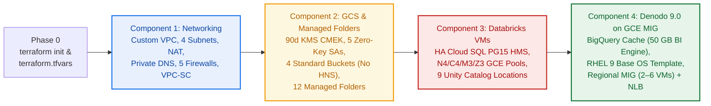
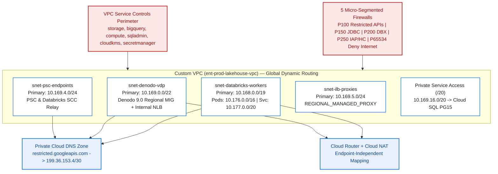
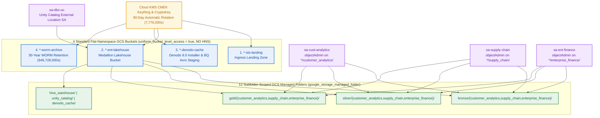
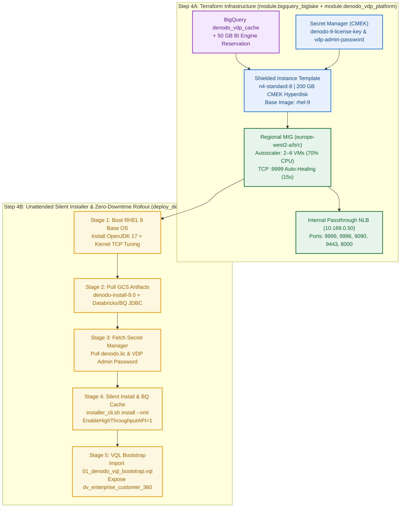

# Step-by-Step Component Installation Guide

> **Component-by-Component Deployment Blueprint** — Install and verify each infrastructure layer independently in strict dependency order:
> 1. **Component 1 — Networking** (`module.network_and_psc`)
> 2. **Component 2 — GCS Managed Folder & Bucket Structure** (`module.gcs_medallion_lakehouse`)
> 3. **Component 3 — Databricks VMs, Unity Catalog & Hive Metastore** (`module.external_hive_metastore` + `module.databricks_workspace`)
> 4. **Component 4 — Denodo 9.0 on GCE Managed Instance Group (MIG)** (`module.bigquery_biglake` + `module.denodo_vdp_platform`)

---

## Installation Dependency Flow



| Automated Step-by-Step CLI | Command |
| :--- | :--- |
| **Dry-Run All 4 Components** | `./scripts/install_components_step_by_step.sh --component all --dry-run` |
| **Install Component 1 (Networking)** | `./scripts/install_components_step_by_step.sh --component 1 --project-id "<YOUR_GCP_PROJECT_ID>"` |
| **Install Component 2 (GCS & Managed Folders)** | `./scripts/install_components_step_by_step.sh --component 2 --project-id "<YOUR_GCP_PROJECT_ID>"` |
| **Install Component 3 (Databricks VMs)** | `./scripts/install_components_step_by_step.sh --component 3 --project-id "<YOUR_GCP_PROJECT_ID>"` |
| **Install Component 4 (Denodo 9.0 on GCE MIG)** | `./scripts/install_components_step_by_step.sh --component 4 --project-id "<YOUR_GCP_PROJECT_ID>"` |

---

## Phase 0 — Prerequisites & Workspace Initialization

```bash
# 1. Authenticate with Google Cloud & set target project
gcloud auth application-default login
export PROJECT_ID="<YOUR_GCP_PROJECT_ID>"
export REGION="europe-west2"
gcloud config set project "${PROJECT_ID}"

# 2. Copy and customize terraform.tfvars
cp terraform/terraform.tfvars.example terraform/terraform.tfvars

# 3. Initialize Terraform providers (google, google-beta, databricks)
terraform -chdir=terraform init
```

---

## Component 1 — Networking (`module.network_and_psc`)

<p align="center">
  
</p>



### 1.1 What Gets Installed in Component 1

| Network Resource | Terraform Resource | CIDR / Specification |
| :--- | :--- | :--- |
| **Custom VPC** | `google_compute_network.lakehouse_vpc` | `REGIONAL` dynamic routing, default routes deleted |
| **Databricks Subnet** | `google_compute_subnetwork.databricks_compute_subnet` | `10.168.0.0/19` + GKE Pods `10.176.0.0/16` + Services `10.177.0.0/20` |
| **Denodo MIG Subnet** | `google_compute_subnetwork.denodo_vdp_subnet` | `10.169.0.0/22` (`private_ip_google_access = true`, Flow Logs enabled) |
| **PSC Endpoint Subnet** | `google_compute_subnetwork.psc_endpoints_subnet` | `10.169.4.0/24` (Private Service Connect & SCC relay) |
| **ILB Proxy Subnet** | `google_compute_subnetwork.ilb_proxy_subnet` | `10.169.5.0/24` (`REGIONAL_MANAGED_PROXY`, `ACTIVE`) |
| **Cloud SQL PSA Peering** | `google_service_networking_connection.private_vpc_connection` | `10.169.16.0/20` peering to `servicenetworking.googleapis.com` |
| **Restricted APIs DNS** | `google_dns_managed_zone.restricted_googleapis_zone` | `*.googleapis.com` $\rightarrow$ `restricted.googleapis.com` (`199.36.153.4/30`) |
| **5 Zero-Trust Firewalls** | `google_compute_firewall.*` | Priorities `100` (API Egress), `150` (Denodo$\rightarrow$DBX), `200` (DBX Internal), `250` (IAP/HC$\rightarrow$Denodo `:9999/:9090/:8000`), `65534` (Deny All Egress) |
| **VPC-SC Perimeter** | `google_access_context_manager_service_perimeter` | Locks down `storage`, `bigquery`, `compute`, `sqladmin`, `cloudkms`, `secretmanager` |

### 1.2 Step-by-Step Commands (Component 1)

```bash
# Step 1.1 — Preview Component 1 (Networking) plan
terraform -chdir=terraform plan -target=module.network_and_psc

# Step 1.2 — Apply Component 1 (Networking)
terraform -chdir=terraform apply -target=module.network_and_psc

# Step 1.3 — Verify Subnets, Firewall Priorities & Restricted Google APIs DNS
gcloud compute networks subnets list \
  --project="${PROJECT_ID}" \
  --network="ent-prod-lakehouse-vpc" \
  --regions="${REGION}"

gcloud compute firewall-rules list \
  --project="${PROJECT_ID}" \
  --filter="network:ent-prod-lakehouse-vpc" \
  --sort-by=priority \
  --format="table(name,direction,priority,sourceRanges.list(),targetTags.list())"

gcloud dns record-sets list \
  --project="${PROJECT_ID}" \
  --zone="ent-prod-lakehouse-restricted-googleapis-dns"
```

---

## Component 2 — GCS Managed Folder & Bucket Structure (`module.gcs_medallion_lakehouse`)

> **Critical Databricks Compatibility Requirement**: **Hierarchical Namespace (HNS) is disabled** across all GCS buckets because Databricks on GCP and Unity Catalog do not support HNS-enabled buckets. Subfolder IAM isolation is enforced on standard flat-namespace GCS buckets (`uniform_bucket_level_access = true`) using **12 GCS Managed Folders (`google_storage_managed_folder`)**.

<p align="center">
  
</p>



### 2.1 Bucket & Managed Folder Matrix

| Bucket / Managed Folder Resource | Terraform Resource | Folder Path / Policy | Bound Service Account |
| :--- | :--- | :--- | :--- |
| **Cloud KMS CMEK Key** | `google_kms_crypto_key.lakehouse_cmek_key` | `rotation_period = "7776000s"` (90 days) | GCS Service Agent + 5 SAs |
| **Bucket 1 — STS Landing** | `google_storage_bucket.sts_landing_bucket` | `gs://<prefix>-sts-landing` (UBLA = `true`, No HNS) | `sa-sts-ingest` (`objectCreator`) |
| **Bucket 2 — Medallion Lakehouse** | `google_storage_bucket.medallion_lakehouse_bucket` | `gs://<prefix>-ent-lakehouse` (UBLA = `true`, No HNS, Soft Delete `14d`) | `sa-dbx-uc` (`objectViewer`) |
| **Bucket 3 — Denodo Cache** | `google_storage_bucket.denodo_cache_staging_bucket` | `gs://<prefix>-denodo-cache` (UBLA = `true`, No HNS, 7d abort cleanup) | `sa-denodo-vdp` (`objectAdmin`) |
| **Bucket 4 — 30-Yr WORM Archive** | `google_storage_bucket.worm_compliance_archive_bucket` | `gs://<prefix>-worm-archive` (`946,728,000s` = 30-Yr Retention) | `sa-dbx-uc` (`objectCreator`) |
| **9 Domain Managed Folders** | `google_storage_managed_folder.medallion_domain_folders` | `{bronze,silver,gold}/{customer_analytics,supply_chain,enterprise_finance}/` | `sa-cust-analytics`, `sa-supply-chain`, `sa-ent-finance` (`objectAdmin`) |
| **3 System Managed Folders** | `google_storage_managed_folder.system_folders` | `hive_warehouse/`, `unity_catalog/`, `denodo_cache/` | `sa-dbx-uc` (`objectAdmin`) |

### 2.2 Step-by-Step Commands (Component 2)

```bash
# Step 2.1 — Preview Component 2 (KMS CMEK, 5 Service Accounts, 4 Standard Buckets, 12 Managed Folders)
terraform -chdir=terraform plan -target=module.gcs_medallion_lakehouse

# Step 2.2 — Apply Component 2
terraform -chdir=terraform apply -target=module.gcs_medallion_lakehouse

# Step 2.3 — Verify Standard GCS Bucket Configuration (UBLA = true, HNS Disabled, CMEK Active)
gcloud storage buckets describe "gs://ent-prod-lakehouse-ent-lakehouse" \
  --project="${PROJECT_ID}" \
  --format="yaml(name,iamConfiguration.uniformBucketLevelAccess,hierarchicalNamespace,encryption)"

# Step 2.4 — List all 12 GCS Managed Folders & Verify Subfolder IAM Policy
gcloud storage managed-folders list "gs://ent-prod-lakehouse-ent-lakehouse" \
  --project="${PROJECT_ID}"

gcloud storage managed-folders get-iam-policy \
  "gs://ent-prod-lakehouse-ent-lakehouse/gold/customer_analytics/" \
  --project="${PROJECT_ID}"
```

---

## Component 3 — Databricks VMs, Unity Catalog & External Hive Metastore (`module.external_hive_metastore` + `module.databricks_workspace`)

```mermaid
flowchart LR
    classDef hms fill:#e8f0fe,stroke:#1a73e8,stroke-width:2px,color:#0d47a1
    classDef dbx fill:#fce8e6,stroke:#c5221f,stroke-width:2px,color:#a50e0e
    classDef uc fill:#fef7e0,stroke:#f29900,stroke-width:2px,color:#b06000

    subgraph HMS["1. External Hive Metastore (module.external_hive_metastore)"]
        PG["Cloud SQL PostgreSQL 15\nREGIONAL HA + Private IP Only\ndb-custom-8-32768 + CMEK"]:::hms
        SQL2["sql/02_hive_metastore_uri_rewrite.sql\nabfss:// -> gs:// URI Migration"]:::hms
    end

    subgraph Pools["2. Databricks GCE VM Node Pools (module.databricks_workspace)"]
        P1["pool-general-etl-n4\nn4-standard-16 (2–32 VMs)"]:::dbx
        P2["pool-photon-c4\nc4-highmem-32 (2–24 VMs)"]:::dbx
        P3["pool-memory-reconcile-m3\nm3-megamem-64 (1–12 VMs)"]:::dbx
        P4["pool-shuffle-heavy-z3\nz3-highmem-88 (2–16 VMs, 9TB NVMe)"]:::dbx
        P5["pool-streaming-dlt-n4\nn4-highmem-8 (2–20 VMs)"]:::dbx
        WH["Photon SQL Warehouse\n2X-Large (1–8 Clusters)"]:::dbx
    end

    subgraph UC["3. Unity Catalog Governance"]
        EXT["9 External Locations\nMapped to GCS Managed Folders"]:::uc
        DDL["sql/03_databricks_unity_catalog_medallion_ddl.sql\nLiquid-Clustered Bronze/Silver/Gold Tables"]:::uc
    end

    PG --> SQL2 --> Pools
    Pools --> EXT --> DDL
```



### 3.1 Databricks GCE VM Pools & Metastore Specification

| Component | Machine Type / SKU | Scaling & Disk | Workload Role |
| :--- | :--- | :--- | :--- |
| **External Hive Metastore** | Cloud SQL `POSTGRES_15` (`db-custom-8-32768`) | `REGIONAL` HA, `250 GB` SSD, Private IP (`PSA /20`) | Legacy Hive metadata (`DBS`, `SDS`, `SERDE_PARAMS`) |
| `pool-general-etl-n4` | `n4-standard-16` (16 vCPU, 64 GB) | `2–32` VMs, Hyperdisk Balanced | Standard Bronze $\rightarrow$ Silver Delta ETL |
| `pool-photon-c4` | `c4-highmem-32` (32 vCPU, 248 GB) | `2–24` VMs, Hyperdisk Extreme | High-concurrency Photon Gold aggregations |
| `pool-memory-reconcile-m3` | `m3-megamem-64` (64 vCPU, 976 GB) | `1–12` VMs, Hyperdisk Balanced | Large in-memory state reconciliation joins |
| `pool-shuffle-heavy-z3` | `z3-highmem-88` (88 vCPU, 704 GB) | `2–16` VMs, `9 TB` Local NVMe SSD | Multi-terabyte shuffle & sort workloads |
| `pool-streaming-dlt-n4` | `n4-highmem-8` (8 vCPU, 64 GB) | `2–20` VMs, Hyperdisk Balanced | Continuous Delta Live Tables (DLT) streaming |
| **Photon SQL Warehouse** | `2X-Large` (`PRO` / Serverless) | `1–8` clusters, `15m` auto-stop | Serves Denodo 9.0 Simba Spark JDBC `:443` queries |

### 3.2 Step-by-Step Commands (Component 3)

```bash
# Step 3.1 — Provision Regional HA Cloud SQL PostgreSQL 15 Hive Metastore & Databricks VM Pools
terraform -chdir=terraform plan \
  -target=module.external_hive_metastore \
  -target=module.databricks_workspace

terraform -chdir=terraform apply \
  -target=module.external_hive_metastore \
  -target=module.databricks_workspace

# Step 3.2 — Verify Cloud SQL Hive Metastore HA Instance & Private IP
HMS_IP=$(terraform -chdir=terraform output -raw hive_metastore_private_ip)
echo "External Hive Metastore Private IP: ${HMS_IP}"

# Step 3.3 — (If migrating legacy Hive tables) Run transactional abfss:// -> gs:// URI rewrite
psql "host=${HMS_IP} port=5432 dbname=hive_metastore user=hive_admin sslmode=require" \
  -f sql/02_hive_metastore_uri_rewrite.sql

# Step 3.4 — Bootstrap Unity Catalog Medallion Schemas & Liquid-Clustered Delta Tables
databricks sql-cli -f sql/03_databricks_unity_catalog_medallion_ddl.sql
```

---

## Component 4 — Denodo 9.0 on GCE Managed Instance Group (MIG) (`module.bigquery_biglake` + `module.denodo_vdp_platform`)

> **Enterprise Base OS Image Architecture**: Rather than using a rigid Marketplace appliance, Component 4 provisions a **Regional GCE Managed Instance Group (`google_compute_region_instance_group_manager`)** booting **Shielded `n4-standard-8` VMs** from **Enterprise Linux Base OS Images** (`projects/rhel-cloud/global/images/family/rhel-9`), paired with **BigQuery (`denodo_vdp_cache` + `50 GB` BI Engine)** and an unattended 5-stage silent installer (`scripts/install_denodo_vmss_startup.sh`).

<p align="center">
  
</p>



### 4.1 Denodo 9.0 GCE MIG & BigQuery Cache Resource Matrix

| Resource | Terraform Resource / Script | Configuration |
| :--- | :--- | :--- |
| **BigQuery Cache Dataset** | `google_bigquery_dataset.denodo_vdp_cache_dataset` | `denodo_vdp_cache` (CMEK encrypted, granted to `sa-denodo-vdp`) |
| **BI Engine Reservation** | `google_bigquery_bi_engine_reservation` | `50 GB` (`53,687,091,200` bytes) in-memory cache acceleration |
| **CMEK Secrets** | `google_secret_manager_secret.*` | `*-denodo-9-license-key` (`denodo.lic`) & `*-denodo-vdp-admin-password` |
| **Enterprise Base OS Template** | `google_compute_instance_template.denodo_9_vmss_template` | `n4-standard-8`, `200 GB` CMEK Hyperdisk, `rhel-9` base image, Shielded Secure Boot + vTPM |
| **Regional MIG (Scale Set)** | `google_compute_region_instance_group_manager.denodo_vdp_mig` | 3 zones (`a/b/c`), `PROACTIVE` update policy (`max_surge = 3`, `max_unavailable = 0`) |
| **TCP `:9999` Health Check** | `google_compute_region_health_check.denodo_vdp_hc` | Probes VDP port `:9999` every `15s` (`300s` initial startup grace period) |
| **Regional CPU Autoscaler** | `google_compute_region_autoscaler.denodo_vdp_autoscaler` | Scales `2` $\rightarrow$ `6` VMs at `70%` CPU utilization |
| **Internal Passthrough NLB** | `google_compute_forwarding_rule.denodo_vdp_ilb_forwarding_rule` | Static VIP (`10.169.0.50`) on ports `9999, 9996, 9090, 9443, 8000` |

### 4.2 Step-by-Step Commands (Component 4)

```bash
# Step 4.1 — Provision BigQuery Denodo Cache (50 GB BI Engine) & Denodo 9.0 GCE Regional MIG
terraform -chdir=terraform plan \
  -target=module.bigquery_biglake \
  -target=module.denodo_vdp_platform

terraform -chdir=terraform apply \
  -target=module.bigquery_biglake \
  -target=module.denodo_vdp_platform

# Step 4.2 — Stage Denodo 9.0 Silent Installer, JDBC Drivers, License Secret & Trigger MIG Rollout
./scripts/deploy_denodo_vm_scaleset.sh \
  --project-id "${PROJECT_ID}" \
  --region "${REGION}" \
  --installer-archive "/path/to/denodo-install-9.0-linux64.tar.gz" \
  --license-file "/path/to/denodo.lic"

# Step 4.3 — Verify Regional MIG Instances, Health Status & Internal NLB VIP Endpoints
gcloud compute instance-groups managed list-instances \
  "ent-prod-lakehouse-denodo-9-vmss-mig" \
  --region="${REGION}" \
  --project="${PROJECT_ID}"

terraform -chdir=terraform output denodo_vdp_jdbc_uri
terraform -chdir=terraform output denodo_design_studio_url
terraform -chdir=terraform output denodo_scheduler_admin_url
```

---

## End-to-End Verification Checklist

```bash
# Run the 20-check offline Terraform & Security validation suite
python3 tests/validate_all.py
```

| Component | Verification Check | Expected Result |
| :--- | :--- | :--- |
| **1. Networking** | `gcloud compute firewall-rules list` | 5 rules active; internet egress blocked at priority `65534`; DNS resolves `*.googleapis.com` to `199.36.153.4/30` |
| **2. GCS & Managed Folders** | `gcloud storage managed-folders list` | 4 Standard GCS buckets (`UBLA = true`, **No HNS**) + 12 Managed Folders with domain SA bindings |
| **3. Databricks VMs** | `terraform output databricks_compute_pools` | HA Cloud SQL PG15 HMS + 5 GCE VM pools (`N4`, `C4`, `M3`, `Z3`) + 9 Unity Catalog External Locations |
| **4. Denodo 9.0 on GCE MIG** | `gcloud compute instance-groups managed list-instances` | `2–6` `RUNNING` Shielded RHEL 9 VMs passing `:9999` health checks behind Internal NLB (`10.169.0.50`) |
